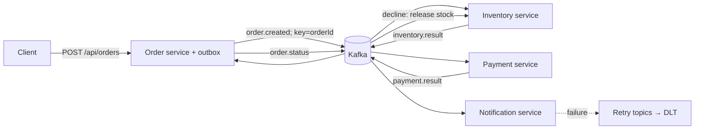

# Kafka Commerce Lab — Spring Boot microservices

This is a runnable, production-shaped order-fulfilment workflow. It is deliberately more than a `Hello Kafka` demo: an HTTP order crosses four independently deployable services, survives duplicate delivery, and compensates inventory when payment fails.



## What is implemented

- Four Spring Boot microservices plus a shared event-contract module.
- Kafka in KRaft mode (no ZooKeeper), Kafka UI, and PostgreSQL through Docker Compose.
- Six partitions per business topic. Every record uses `orderId` as its key, preserving per-order ordering while allowing parallelism.
- Separate consumer groups: inventory, payments, the order projection, and notifications each receive their own copy.
- Transactional outbox on order creation, preventing a committed order with no event.
- At-least-once delivery with stable event IDs and durable consumer deduplication.
- Pessimistic stock locking to make concurrent reservations safe.
- Choreographed saga: inventory rejection stops payment; payment rejection updates the order and compensates (releases) stock.
- Exponential non-blocking notification retries and a dead-letter topic.
- Versioned topic names, JSON event contracts, actuator health/metrics, manual acknowledgements, replayable logs, and deterministic demo failures.

## Run it

Requirements: Java 17+, Maven, and Docker.

```powershell
docker compose up -d
mvn -pl order-service -am spring-boot:run
```

Open three more terminals:

```powershell
mvn -pl inventory-service -am spring-boot:run
mvn -pl payment-service -am spring-boot:run
mvn -pl notification-service -am spring-boot:run
```

### Run it on Linux (bash)

```bash
docker compose up -d
scripts/run-all.sh        # starts all four services, logs + pids in run-logs/
scripts/health-check.sh   # actuator, Kafka UI, Kafka and Postgres port checks
scripts/stop-all.sh       # stop services (add --infra to also stop Docker)
```

Or manually, in four terminals: `mvn -pl <service> -am spring-boot:run`.
Service ports: order 8081, inventory 8082, payment 8083, notification 8084.

Kafka UI is at <http://localhost:8080>. The order API is at <http://localhost:8081>.

Create a successful order (seeded SKUs are `LAPTOP-14`, `HEADSET-PRO`, and `USB-C-DOCK`):

```powershell
$body = @{
  customerEmail = "learner@example.com"
  items = @(@{ sku="LAPTOP-14"; quantity=1; unitPrice=1299.00 })
} | ConvertTo-Json -Depth 5
$order = Invoke-RestMethod -Method Post -Uri http://localhost:8081/api/orders -ContentType application/json -Body $body
$order
Invoke-RestMethod http://localhost:8081/api/orders/$($order.id)
```

The POST initially returns `PENDING`; poll the GET until it becomes `CONFIRMED`. Watch each topic in Kafka UI to follow the event chain.

## Failure exercises that represent real incidents

1. **Inventory rejection:** request quantity `999`. The order becomes `REJECTED`, and no payment is attempted.
2. **Payment decline and compensation:** make the total exceed `5000.00`. The order becomes `PAYMENT_FAILED`; inventory restores the reserved quantity.
3. **Broker outage:** stop Kafka, create an order, then restart Kafka. The database outbox row remains unpublished and is delivered after recovery.
4. **Duplicate delivery:** reset the `inventory-workers` group offset in Kafka UI and replay. `processed_event` prevents a second reservation.
5. **Consumer scaling:** run a second inventory instance. Kafka rebalances six partitions across the two members; one partition is owned by only one member in the group.
6. **Independent subscribers:** compare `inventory-workers` and `payment-workers`. Consumer groups are broadcast between groups and load-balanced within a group.
7. **Poison message:** temporarily throw from `NotificationListener.notifyCustomer`. Observe retry topics with 1s/2s/4s backoff and eventual DLT routing.
8. **Ordering:** rapidly submit several events with the same key and then different keys. Same-order events stay ordered; different orders can execute concurrently.

## Important production trade-offs

The contracts are JSON at runtime to keep the lab self-contained; Avro schemas and a Schema Registry are now provided for governed evolution (see below), as are a Debezium CDC mode for the outbox, and a 3-broker production Kafka profile (RF=3, `min.insync.replicas=2`). Still out of scope for the lab: TLS/SASL, ACLs, quotas, and tested DLT operations runbooks.

Kafka's “exactly once” does not magically create one transaction across Kafka, PostgreSQL, payment gateways, and email. This project instead demonstrates the practical combination: outbox + idempotent consumers + stable keys + compensation.

## Code map

- `order-service`: REST API, order projection, transactional outbox, topic creation.
- `inventory-service`: stock locking, durable deduplication, reservation and compensation.
- `payment-service`: idempotent authorization and deterministic decline path.
- `notification-service`: independent consumer group, retries, and DLT.
- `event-contracts`: immutable event records and versioned topic names.

Each service uses a visible layered package structure:

```text
controller/   REST controllers and Kafka inbound adapters
service/      business rules and transaction boundaries
repository/   Spring Data persistence interfaces
model/        JPA/domain entities
messaging/    Kafka outbound publishers
config/       topic and seed-data configuration
```

Not every service needs every layer. For example, `notification-service` has no database, so it intentionally has no repository or JPA model. Its Kafka controller delegates delivery behavior to `NotificationService`.

## Upgrades: tests, databases, security, observability, governance

**Tech stack (updated):** Java 17 · Spring Boot 3.5 · Spring Kafka · Spring Security (JWT, order-service) · Spring Data JPA · Flyway · PostgreSQL 17 (default) / Microsoft SQL Server (profile) · Apache Kafka 3.9 (KRaft) · Debezium (optional CDC) · Avro schemas + Schema Registry (governance only) · Prometheus / Grafana · JUnit 5 / Mockito / Testcontainers · Docker Compose · GitHub Actions CI · Perl reconciliation script.

### Tests

```bash
mvn test        # unit tests only; no Docker required
```

27 unit tests cover the saga rules: inventory rejection (no payment attempted),
payment decline releasing reserved stock, duplicate-delivery deduplication in
both inventory and payment, order creation totals + outbox write, order status
transitions, outbox publishing, JWT issue/validation, and the HTTP security
rules (no token -> 401 on POST /api/orders, valid token -> 201, GET public,
demo token endpoint). A Testcontainers integration test
(`OrderPostgresIntegrationTest`, `@Tag("integration")`, `@Disabled`) is
provided for Docker environments and is skipped in the default run.
CI (`.github/workflows/ci.yml`, ubuntu-latest, Temurin 17) runs the unit
tests plus `bash -n`/shellcheck on the scripts, `perl -c`, and Avro schema
validation.

### Flyway migrations (who owns the schema)

- `docker/postgres/init.sql` only creates the three schemas (`orders`,
  `inventory`, `payments`) and the database. It creates **no tables**.
- Each JPA service owns its tables through Flyway:
  `<service>/src/main/resources/db/migration/V1__init.sql`, matching its JPA
  entities exactly. Hibernate runs with `ddl-auto: validate`.

### Microsoft SQL Server profile

PostgreSQL stays the default. To run the JPA services against SQL Server:

```bash
docker compose -f docker-compose.yml -f docker-compose.sqlserver.yml up -d mssql
mvn -pl order-service spring-boot:run -Dspring-boot.run.profiles=sqlserver
```

Each JPA service has an `application-sqlserver.yml` (mssql-jdbc driver,
SQL Server dialect, `dbo` schema). Flyway is disabled under this profile
(the migrations are PostgreSQL dialect), so Hibernate manages the schema
there (`ddl-auto: update`) — demo scope, verified by configuration only.

### Linux tooling

`scripts/run-all.sh`, `scripts/health-check.sh`, and `scripts/stop-all.sh`
(see "Run it on Linux" above) provide the basic system-administration
workflow alongside the original PowerShell instructions.

### Perl end-of-day reconciliation

`scripts/reconcile.pl` compares orders vs payments and flags amount
mismatches, orders stuck in PENDING, payments with no order, and CONFIRMED
orders with no approved payment. It runs with core Perl only in CSV mode;
DBI mode (`--dsn`) is optional and degrades with a clear message if DBI
is not installed:

```bash
perl scripts/reconcile.pl --orders scripts/sample-data/orders.csv \
                          --payments scripts/sample-data/payments.csv
# sample data contains planted discrepancies; exit code 1 = discrepancies found
```

### Order API security (JWT)

Only `order-service` is secured. Creating an order requires a demo JWT;
reads and health stay public:

```bash
TOKEN=$(curl -s -X POST localhost:8081/api/auth/token \
  -H 'Content-Type: application/json' \
  -d '{"username":"demo","password":"demo-password"}' | sed -E 's/.*"token":"([^"]+)".*/\1/')
curl -X POST localhost:8081/api/orders -H "Authorization: Bearer $TOKEN" \
  -H 'Content-Type: application/json' \
  -d '{"customerEmail":"learner@example.com","items":[{"sku":"LAPTOP-14","quantity":1,"unitPrice":1299.00}]}'
```

Credentials come from `DEMO_USERNAME` / `DEMO_PASSWORD`, the signing secret
from `JWT_SECRET` (HS256, JDK crypto — change both outside local demos).

### Avro + Schema Registry (governance only)

Avro schemas for all four contracts live in
`event-contracts/src/main/avro/`. **Runtime serialization remains JSON** —
the schemas + registry exist so contract changes can be reviewed and
compatibility-checked before any future serialization switch:

```bash
docker compose -f docker-compose.yml -f docker-compose.avro.yml up -d schema-registry
scripts/check-schema-compatibility.sh   # validates every .avsc
```

### Prometheus + Grafana

All services expose `/actuator/prometheus` (Micrometer registry added).
With services running on the host:

```bash
docker compose -f docker-compose.yml -f docker-compose.observability.yml up -d prometheus grafana
# Prometheus http://localhost:9090, Grafana http://localhost:3000 (admin/commerce)
```

A starter dashboard (JVM memory/CPU, Kafka consumer lag, HTTP rate) is in
`grafana/dashboards/commerce-platform.json` and is auto-provisioned.

### Debezium CDC (alternative to outbox polling)

Default mode stays the polling `OutboxPublisher`. CDC mode streams the
`orders.outbox_event` table via Debezium instead:

```bash
docker compose -f docker-compose.yml -f docker-compose.cdc.yml up -d
curl -X POST -H 'Content-Type: application/json' \
  --data @debezium/order-outbox-connector.json http://localhost:8089/connectors
```

The CDC override sets `wal_level=logical` on PostgreSQL (required by the
pgoutput plugin). In CDC mode, disable the polling publisher so events are
not published twice.

### Production Kafka profile

`docker-compose.prod.yml` runs a 3-broker KRaft cluster (node ids 1–3,
controller quorum of 3) with replication factor 3 and
`min.insync.replicas=2` for offsets/transaction topics and defaults:

```bash
docker compose -f docker-compose.prod.yml up -d
```

> Docker-dependent pieces (SQL Server, Schema Registry, Prometheus/Grafana,
> Debezium, prod Kafka cluster, Testcontainers test) are provided as
> configuration in this repo; they were syntax-validated but not run in the
> environment where these upgrades were built, which had no Docker.
