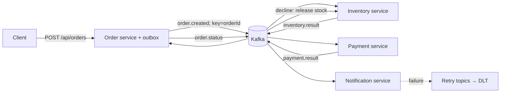

# Kafka Commerce Lab — Spring Boot microservices

This is a runnable, production-shaped order-fulfilment workflow. It is deliberately more than a `Hello Kafka` demo: an HTTP order crosses four independently deployable services, survives duplicate delivery, and compensates inventory when payment fails.



## What is implemented

- Four Spring Boot microservices plus a shared event-contract module.
- Kafka in KRaft mode (no ZooKeeper), Kafka UI, and PostgreSQL through Docker Compose.
- Six partitions per business topic. Every record uses `orderId` as its key, preserving per-order ordering while allowing parallelism.
- Separate consumer groups: inventory, payments, the order projection, and notifications each receive their own copy.
- Transactional outbox on order creation, preventing a committed order with no event.
- At-least-once delivery with stable event IDs and durable consumer deduplication.
- Pessimistic stock locking to make concurrent reservations safe.
- Choreographed saga: inventory rejection stops payment; payment rejection updates the order and compensates (releases) stock.
- Exponential non-blocking notification retries and a dead-letter topic.
- Versioned topic names, JSON event contracts, actuator health/metrics, manual acknowledgements, replayable logs, and deterministic demo failures.

## Run it

Requirements: Java 17+, Maven, and Docker.

```powershell
docker compose up -d
mvn -pl order-service -am spring-boot:run
```

Open three more terminals:

```powershell
mvn -pl inventory-service -am spring-boot:run
mvn -pl payment-service -am spring-boot:run
mvn -pl notification-service -am spring-boot:run
```

Kafka UI is at <http://localhost:8080>. The order API is at <http://localhost:8081>.

Create a successful order (seeded SKUs are `LAPTOP-14`, `HEADSET-PRO`, and `USB-C-DOCK`):

```powershell
$body = @{
  customerEmail = "learner@example.com"
  items = @(@{ sku="LAPTOP-14"; quantity=1; unitPrice=1299.00 })
} | ConvertTo-Json -Depth 5
$order = Invoke-RestMethod -Method Post -Uri http://localhost:8081/api/orders -ContentType application/json -Body $body
$order
Invoke-RestMethod http://localhost:8081/api/orders/$($order.id)
```

The POST initially returns `PENDING`; poll the GET until it becomes `CONFIRMED`. Watch each topic in Kafka UI to follow the event chain.

## Failure exercises that represent real incidents

1. **Inventory rejection:** request quantity `999`. The order becomes `REJECTED`, and no payment is attempted.
2. **Payment decline and compensation:** make the total exceed `5000.00`. The order becomes `PAYMENT_FAILED`; inventory restores the reserved quantity.
3. **Broker outage:** stop Kafka, create an order, then restart Kafka. The database outbox row remains unpublished and is delivered after recovery.
4. **Duplicate delivery:** reset the `inventory-workers` group offset in Kafka UI and replay. `processed_event` prevents a second reservation.
5. **Consumer scaling:** run a second inventory instance. Kafka rebalances six partitions across the two members; one partition is owned by only one member in the group.
6. **Independent subscribers:** compare `inventory-workers` and `payment-workers`. Consumer groups are broadcast between groups and load-balanced within a group.
7. **Poison message:** temporarily throw from `NotificationListener.notifyCustomer`. Observe retry topics with 1s/2s/4s backoff and eventual DLT routing.
8. **Ordering:** rapidly submit several events with the same key and then different keys. Same-order events stay ordered; different orders can execute concurrently.

## Important production trade-offs

The contracts are JSON to keep the lab self-contained. A larger organization would usually put Avro/Protobuf schemas in a registry and enforce compatibility in CI. The order outbox uses polling; Debezium CDC is the natural next step at higher throughput. Local Kafka uses replication factor 1; production should use at least three brokers, replication factor 3, `min.insync.replicas=2`, TLS/SASL, ACLs, quotas, alerting on consumer lag, and tested DLT operations.

Kafka's “exactly once” does not magically create one transaction across Kafka, PostgreSQL, payment gateways, and email. This project instead demonstrates the practical combination: outbox + idempotent consumers + stable keys + compensation.

## Code map

- `order-service`: REST API, order projection, transactional outbox, topic creation.
- `inventory-service`: stock locking, durable deduplication, reservation and compensation.
- `payment-service`: idempotent authorization and deterministic decline path.
- `notification-service`: independent consumer group, retries, and DLT.
- `event-contracts`: immutable event records and versioned topic names.

Each service uses a visible layered package structure:

```text
controller/   REST controllers and Kafka inbound adapters
service/      business rules and transaction boundaries
repository/   Spring Data persistence interfaces
model/        JPA/domain entities
messaging/    Kafka outbound publishers
config/       topic and seed-data configuration
```

Not every service needs every layer. For example, `notification-service` has no database, so it intentionally has no repository or JPA model. Its Kafka controller delegates delivery behavior to `NotificationService`.
